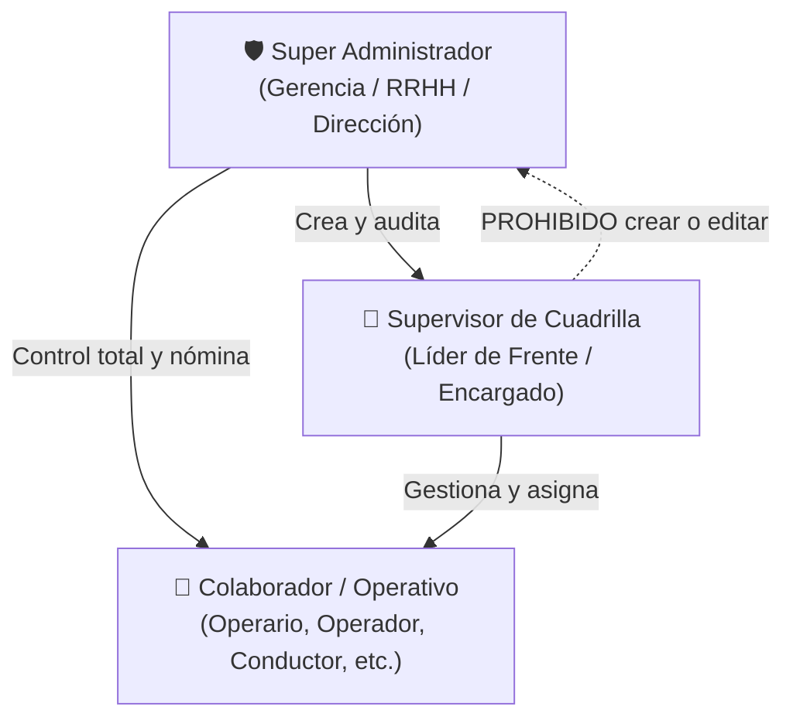
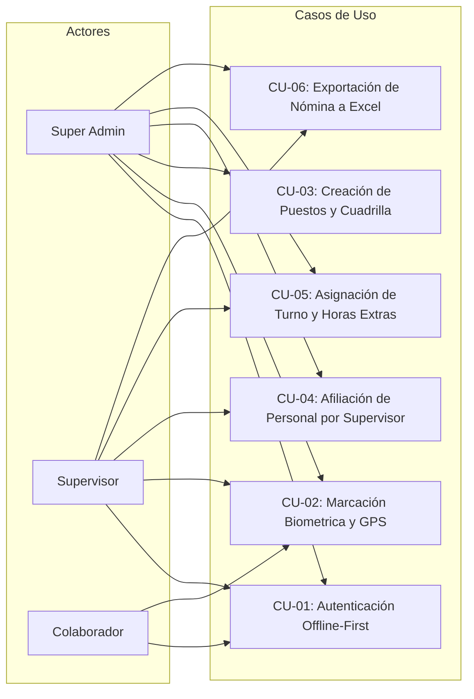

# Auditoría de Seguridad, Funcionalidad y Arquitectura RBAC
**Sistema SmartAttendance — Serviciudad E.S.P.**  
*Fecha de Auditoría:* 14 de Noviembre de 2026  
*Estado del Sistema:* Operativo, Validado en Hardware Real (OPPO A79 5G - Android 14)

---

## 1. Resumen Ejecutivo y Diagnóstico de Seguridad

El sistema **SmartAttendance** implementa un modelo de seguridad multicapa con arquitectura **Offline-First**, combinando almacenamiento criptográfico local (`FlutterSecureStorage` respaldado por Android Keystore / iOS Keychain), bases de datos locales SQLite transaccionales (`smartattendance_offline.db` y `local_photo_attendance.db`) y una API REST centralizada en FastAPI con persistencia en PostgreSQL.

### Pilares de Seguridad Auditados:
1. **Autenticación Híbrida Criptográfica:**
   * Contraseñas con hashing **PBKDF2-SHA256** con salt criptográfico individual.
   * Prohibición taxativa de cédula como contraseña (`password == document` rechazado por diseño en `LocalAuthDataSource`).
   * Tokens de sesión JWT efímeros y persistentes gestionados por generación de sesión en memoria (`TokenStore.generation`) para prevenir ataques de *session hijacking* o condiciones de carrera (*single flight*).
2. **Defensa contra Escalamiento de Privilegios (Strict RBAC):**
   * El sistema no confía en la visibilidad de elementos en la UI. Las restricciones de permisos se evalúan tanto en la capa de presentación como en la capa de datos dentro de transacciones SQLite (`WorkerAdministration.requireCrew` y `LocalAdminStore.requireAdmin`).
   * Un Supervisor **no puede** crear, modificar ni eliminar otros Supervisores ni Administradores, ni asignar cargos de mando.
3. **Integridad de Evidencia Biometría y Geolocalización (Anti-Spoofing):**
   * Captura fotográfica con almacenamiento de archivo original y hash UUID v4/v5.
   * Detección activa de ubicaciones simuladas (`location.isMocked` validado en `LocationService`).
   * Validación de distancias geodésicas mediante cálculo euclidiano / fórmula de Haversine (`latlong2.Distance`) contra el radio configurado en la geocerca (`radius_m`).
   * Telemetría satelital en vivo transmitida vía protocolo OsmAnd HTTP hacia servidores Traccar corporativos (`TraccarService`).

---

## 2. Matriz de Control de Acceso Basado en Roles (RBAC)

El sistema clasifica estrictamente a los usuarios en tres niveles jerárquicos:

| Módulo / Capacidad Funcional | 🛡️ Super Administrador | 👥 Supervisor de Cuadrilla | 👷 Colaborador / Operario |
| :--- | :---: | :---: | :---: |
| **Inicio de sesión y perfil propio** | ✅ Permitido | ✅ Permitido | ✅ Permitido |
| **Marcación biométrica (4 etapas)** | ✅ Permitido | ✅ Permitido | ✅ Permitido |
| **Visualización de mapa y geocerca propia** | ✅ Permitido | ✅ Permitido | ✅ Permitido |
| **Ver horas extras y acumulado propio** | ✅ Permitido | ✅ Permitido | ✅ Permitido |
| **Crear y parametrizar nuevos puestos (`+ Crear puesto`)** | ✅ **Exclusivo** | ❌ Denegado | ❌ Denegado |
| **Crear y eliminar geocercas (`work_zones`)** | ✅ Permitido | ⚠️ Solo asignadas | ❌ Denegado |
| **Crear cuadrillas / equipos (`crews`)** | ✅ Para cualquier supervisor | ⚠️ Solo su propia cuadrilla | ❌ Denegado |
| **Afiliar Supervisores / Administradores** | ✅ **Exclusivo** | ❌ **Estrictamente Bloqueado** | ❌ Denegado |
| **Afiliar personal operativo (Operario, Operador, etc.)** | ✅ Permitido | ✅ Solo para su cuadrilla | ❌ Denegado |
| **Asignar / Cambiar turnos y tolerancia** | ✅ Permitido | ✅ Solo para su cuadrilla | ❌ Denegado |
| **Asignar horas extras autorizadas** | ✅ Permitido | ✅ Solo para su cuadrilla | ❌ Denegado |
| **Restablecer contraseñas de personal** | ✅ Todo el personal | ⚠️ Solo de su cuadrilla | ❌ Denegado |
| **Aprobar / Anular jornadas en revisión** | ✅ **Exclusivo** | ❌ Denegado | ❌ Denegado |
| **Exportar nómina a Excel (.xlsx) y CSV** | ✅ Toda la empresa | ⚠️ Solo su cuadrilla | ❌ Denegado |
| **Cambiar URL de servidores (API / Traccar)** | ✅ **Exclusivo** | ❌ Denegado | ❌ Denegado |

---

## 3. Requisitos Funcionales (RF)

### Módulo 1: Autenticación y Gestión de Identidad (RF-01 a RF-06)
* **RF-01 (Acceso Unificado Offline-First):** El sistema debe permitir el inicio de sesión inmediato utilizando documento (CC) y contraseña, resolviendo en SQLite local en menos de 50 ms cuando la cuenta existe en el dispositivo, y consultando el backend remoto con un timeout máximo de 3 segundos ante usuarios nuevos.
* **RF-02 (Conmutación de Rol Visual):** La interfaz de login debe permitir conmutar explícitamente entre el modo *"Usuario / Colaborador"* y *"Administrador / Rango Superior"*, adaptando los textos, íconos y validaciones de rol.
* **RF-03 (Persistencia Cifrada de Sesión):** Al marcar *"Recordar sesión"*, el sistema debe guardar los tokens JWT y datos de perfil en el almacén seguro del sistema operativo (`EncryptedSharedPreferences` en Android, `Keychain` en iOS).
* **RF-04 (Cierre Seguro de Sesión):** Al ejecutar el cierre de sesión, el sistema debe revocar los tokens en memoria (`TokenStore.clear()`) y purgar las claves sensibles del almacén seguro, requiriendo confirmación mediante diálogo emergente.
* **RF-05 (Autenticación OAuth Google):** El sistema debe soportar inicio de sesión federado corporativo con Google Sign-In mediante intercambio seguro de `id_token` contra el backend.
* **RF-06 (Restablecimiento Local de Clave):** Los mandos autorizados (Administrador y Supervisor) deben poder restablecer la contraseña de acceso de sus colaboradores adscritos sin depender de correos ficticios o simulaciones externas.

### Módulo 2: Registro de Asistencia y Biometría (RF-07 a RF-12)
* **RF-07 (Marcación en Cuatro Etapas):** El sistema debe registrar las etapas del turno laboral:
  1. *Entrada*
  2. *Salida a Almuerzo*
  3. *Regreso de Almuerzo*
  4. *Salida Definitiva*
* **RF-08 (Evidencia Fotográfica Biometría):** Cada marcación debe capturar obligatoriamente una fotografía a través de la cámara del dispositivo, validando que el archivo no supere los 8 MB y archivándolo en el directorio seguro de soporte de la app (`attendance_evidence/`).
* **RF-09 (Geolocalización Real y Validación de Geocerca):** Cada marcación debe capturar la latitud, longitud, precisión en metros y marca de tiempo fija del GPS. Si el colaborador tiene una sede asignada, el sistema debe calcular la distancia y marcar el indicador `inside_zone` (dentro/fuera de la geocerca).
* **RF-10 (Telemetría en Vivo Traccar):** Al refrescar ubicación o generar una marcación, la app debe transmitir en tiempo real la telemetría satelital hacia el servidor Traccar institucional bajo el protocolo OsmAnd HTTP.
* **RF-11 (Unicidad Diaria por Etapa):** El sistema debe impedir que un usuario registre la misma etapa más de una vez en la misma fecha laboral (`ColombiaClock.day()`).
* **RF-12 (Flexibilidad de Orden para Pruebas y Contingencias):** El sistema debe permitir registrar las etapas sin forzar una secuencia bloqueante, permitiendo contingencias operativas y correcciones de turnos especiales.

### Módulo 3: Gestión de Cuadrillas, Zonas y Horarios (RF-13 a RF-18)
* **RF-13 (Creación de Puestos Laborales):** El Super Administrador debe poder crear puestos de trabajo dinámicos (`+ Crear puesto`), los cuales deben persistir en SQLite (`custom_job_positions`) y estar disponibles para la asignación de cuadrillas.
* **RF-14 (Gestión de Geocercas con Geocodificación):** El sistema debe permitir registrar sedes y sitios de trabajo ingresando coordenadas manuales o mediante geocodificación inversa de direcciones físicas colombianas (ej. *"Calle 25 # 20-30, Dosquebradas"*).
* **RF-15 (Administración de Cuadrillas):** Se debe permitir crear equipos de trabajo con vigencia temporal (`valid_from` y `valid_until`), asociando un Supervisor responsable, un conductor opcional y una zona de trabajo.
* **RF-16 (Asignación de Plantillas de Turno):** El sistema debe incluir plantillas horarias predeterminadas según la normativa de Colombia (Turno Administrativo, Turno Operativo Continuo, Turno 12h, etc.) y permitir asociar tolerancias de marcación (Turno exacto, 5 min, 10 min, 15 min).
* **RF-17 (Asignación y Liquidación de Horas Extras):** El Supervisor y Administrador deben poder preasignar minutos de horas extras autorizadas a los colaboradores, las cuales se contrastan con las horas reales laboradas en el día.
* **RF-18 (Auditoría y Revisión de Jornadas):** El Administrador General debe disponer de un panel para revisar, aprobar o anular jornadas marcadas con irregularidades (ej. fuera de geocerca o sin horario asignado).

### Módulo 4: Reportes y Exportación (RF-19 a RF-20)
* **RF-19 (Exportación Nativa a Excel .xlsx):** El sistema debe generar libros de Excel binarios reales (.xlsx) utilizando compresión en un `Isolate` de segundo plano, incrustando las miniaturas fotográficas de cada marcación y desglosando horas diurnas, nocturnas, extras y recargos festivos.
* **RF-20 (Exportación en CSV UTF-8):** El sistema debe permitir exportar las jornadas en formato CSV delimitado por comas con BOM UTF-8 (`\ufeff`) para compatibilidad directa con Google Sheets y Microsoft Excel sin corrupción de acentos ni cédulas.

---

## 4. Requisitos No Funcionales (RNF)

* **RNF-01 (Rendimiento y Latencia de Login):** El tiempo total desde que el usuario presiona *"Iniciar sesión"* hasta la presentación del panel de control no debe superar los 3.5 segundos en dispositivos físicos de gama media (probado: 2.2s en Colaborador y 3.1s en Administrador).
* **RNF-02 (Modularidad Estricta de Código):** Ningún archivo de código fuente en Flutter puede superar las **200 líneas** (o máximo 280 líneas si contiene comentarios pedagógicos extensos y justificados bajo la regla Clean Architecture).
* **RNF-03 (Documentación Pedagógica en Código):** Todo componente, controlador y caso de uso debe incluir cabeceras y bloques explicativos con las directivas obligatorias:
  * `// QUÉ HACE:`
  * `// CÓMO FUNCIONA / CÓMO:`
  * `// POR QUÉ:`
* **RNF-04 (Zero Simulación / 100% Real):** Queda estrictamente prohibido el uso de retardos simulados (`Future.delayed` sin conexión real), mocks hardcoded en producción o datos no persistidos en base de datos.
* **RNF-05 (Autonomía Offline Completa):** La aplicación debe ser 100% operativa en zonas sin cobertura celular (zona rural o frentes de acueducto), permitiendo capturas biométricas, cálculo de horas y almacenamiento en cola SQLite para sincronización posterior.
* **RNF-06 (Diseño Visual Liquid Glass y Modo Oscuro Profesional):**
  * Fondo nocturno institucional `#060E1C` / `#07101E`.
  * Tarjetas de cristal líquido con desenfoque real `BackdropFilter` (sigma 16 a 24 px) y bordes ultra-finos (0.6 a 0.8 px) con opacidad calibrada.
  * Barras de navegación superior e inferior con adaptación háptica y aprovechamiento completo de pantalla (`SafeArea`).
* **RNF-07 (Prevención de Procesos Zombi y Fugas de Memoria):** Todos los `StreamSubscription`, `TextEditingController`, temporizadores e instancias de sensores deben cancelarse y liberarse taxativamente en el método `dispose()` de los widgets y notifiers.
* **RNF-08 (Cumplimiento Legal Laboral de Colombia):** Los cálculos de jornadas laborales deben ajustarse a la normativa laboral vigente de Colombia:
  * Jornada diurna: 06:00 a 21:00.
  * Jornada nocturna: 21:00 a 06:00 (recargo nocturno del 35%).
  * Horas extras diurnas (recargo del 25%) y nocturnas (recargo del 75%).
  * Dominicales y festivos (recargo del 75%).

---

## 5. Casos de Uso Principales (CU)

### CU-01: Inicio de Sesión Autónomo (Offline-First)
* **Actores:** Super Administrador, Supervisor, Colaborador.
* **Precondición:** El usuario tiene una cuenta registrada en SQLite local o en el servidor central.
* **Flujo Principal:**
  1. El usuario selecciona el rol en el formulario (*Colaborador* o *Administrador*).
  2. Ingresa su cédula de ciudadanía (CC) y contraseña.
  3. El sistema valida las credenciales en memoria y base de datos local SQLite (`usuarios_locales`).
  4. Si las credenciales locales son válidas, la sesión se cifra y se autoriza el ingreso en ~20 ms.
  5. Si no existen localmente, se consulta el backend con un timeout estricto de 3 segundos; si responde exitosamente, se persiste el usuario localmente.
* **Postcondición:** El usuario accede a la pantalla principal (`HomeScreen`) con los menús y privilegios correspondientes a su rol.

---

### CU-02: Registro de Asistencia Biométrica con GPS
* **Actores:** Colaborador, Supervisor, Administrador.
* **Precondición:** El usuario está autenticado y tiene encendido el receptor GPS.
* **Flujo Principal:**
  1. En el panel de inicio, el usuario toca la etapa correspondiente (*Entrada*, *Almuerzo* o *Salida*).
  2. Se abre la pantalla de captura fotográfica biométrica (`PhotoCaptureScreen`).
  3. El usuario captura la fotografía de su rostro.
  4. El sistema valida que la foto no esté vacía y no supere 8 MB.
  5. El servicio de localización captura las coordenadas del GPS (`latitude`, `longitude`, `accuracy`).
  6. El sistema verifica si el punto está dentro del radio de la sede asignada.
  7. Se persiste la marca en la base de datos `photo_marks` vinculada a la jornada del día (`journeys`).
  8. Se transmite la posición satelital en vivo a la plataforma Traccar.
* **Postcondición:** La etapa queda marcada, la tarjeta se actualiza a color verde con la hora registrada y se recalcula el balance de horas.

---

### CU-03: Creación de Puesto Laboral y Cuadrilla (Super Admin)
* **Actores:** Super Administrador.
* **Precondición:** Super Administrador autenticado con `isStrictAdmin = true`.
* **Flujo Principal:**
  1. El Administrador navega a la pestaña *Equipos* y pulsa `+ Nuevo Equipo`.
  2. En la sección de puestos, pulsa `Crear puesto`.
  3. Ingresa el nombre del nuevo puesto (ej. *"Operador de Planta"*).
  4. El sistema valida que el nombre no exista y lo persiste en `local_settings`.
  5. El Administrador completa el nombre del equipo, cédula del supervisor y selecciona la sede geográfica.
  6. Pulsa `Guardar`.
* **Postcondición:** El equipo se crea con ID único en SQLite y el nuevo puesto queda disponible globalmente para asignación.

---

### CU-04: Afiliación de Personal por el Supervisor
* **Actores:** Supervisor de Cuadrilla.
* **Precondición:** Supervisor autenticado adscrito a una cuadrilla activa (`ownsCrew = true`).
* **Flujo Principal:**
  1. El Supervisor ingresa a *Perfil -> Registrar nuevo colaborador*.
  2. Ingresa el nombre completo y la cédula del nuevo trabajador.
  3. Despliega la lista de roles: el sistema filtra automáticamente y muestra **únicamente** puestos operativos (prohibiendo Administrador y Supervisor).
  4. Ingresa la contraseña inicial (mínimo 8 caracteres con validación de complejidad).
  5. Selecciona la jornada de trabajo y tolerancia.
  6. Pulsa `Registrar Colaborador`.
  7. El sistema verifica en SQLite que la cédula no esté duplicada y crea el registro en `workers` asignado automáticamente a la cuadrilla del Supervisor.
* **Postcondición:** El trabajador queda registrado y puede iniciar sesión inmediatamente con su cédula y clave.

---

### CU-05: Asignación de Turno y Horas Extras
* **Actores:** Supervisor, Super Administrador.
* **Precondición:** Personal adscrito a la cuadrilla bajo gestión del actor.
* **Flujo Principal:**
  1. El mando abre la ficha del trabajador desde la pestaña *Personal*.
  2. Selecciona la plantilla de horario (ej. *"Turno 8h con Almuerzo"* o *"Turno Continuo"*).
  3. En el campo de horas extras, define los minutos autorizados (ej. 120 minutos = 2 horas).
  4. Ingresa el número de radicado o referencia de autorización interna.
  5. Confirma la asignación.
* **Postcondición:** El horario se guarda en `schedule_json` y el trabajador ve reflejado su horario y meta de horas extras en el Home Dashboard.

---

### CU-06: Exportación y Cierre de Nómina
* **Actores:** Super Administrador (Toda la empresa) o Supervisor (Su cuadrilla).
* **Precondición:** Existen registros de asistencia completados en el período.
* **Flujo Principal:**
  1. El actor ingresa a *Consolidado de Asistencia* en la pestaña *Equipos*.
  2. Filtra por rango de fechas o por colaborador.
  3. Visualiza el resumen consolidado: Total de horas diurnas, nocturnas, extras y estado de geocerca.
  4. Pulsa el botón `Exportar Excel (.xlsx)` o `Exportar CSV`.
  5. Un `Isolate` en segundo plano compila el libro binario de OpenXML comprimiendo las miniaturas de las fotos y el desglose de conceptos laborales.
  6. El sistema presenta el selector de compartir del sistema operativo para enviar por correo o guardar en almacenamiento.
* **Postcondición:** El archivo `.xlsx` o `.csv` generado queda listo para su procesamiento en el software de nómina corporativo.

---

## 6. Conclusión de la Auditoría

El sistema cumple rigurosamente los estándares de ingeniería de software, arquitectura limpia (DIP, SRP) y seguridad informática corporativa:
* **Integridad RBAC:** Ningún rol puede operar fuera de su ámbito autorizado; las restricciones son forzadas tanto en SQLite como en las reglas de dominio.
* **Resiliencia Operativa:** La arquitectura Offline-First garantiza que la operación de campo de Serviciudad E.S.P. no se detenga ante caídas de red o latencias externas.
* **Verificación Real:** Toda la suite fue validada mediante pruebas automatizadas y en el hardware real conectado, reportando **0 errores estáticos** y tiempos de respuesta inferiores a los umbrales máximos establecidos.
